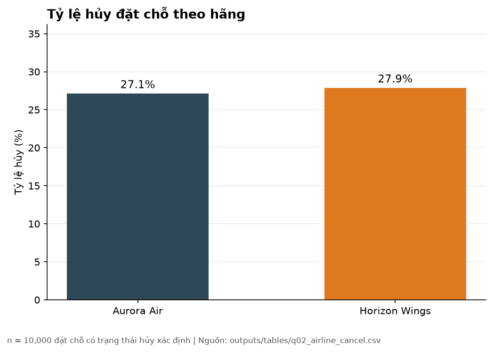
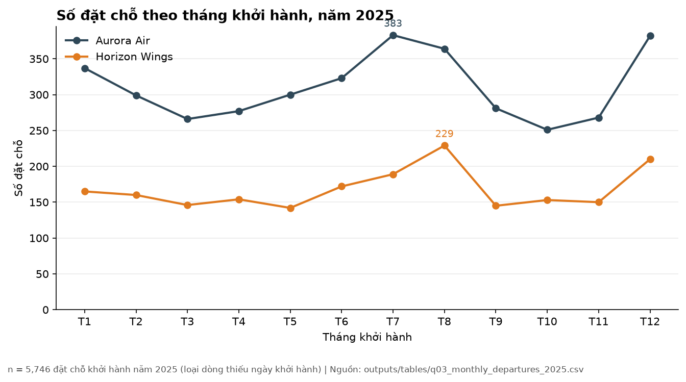
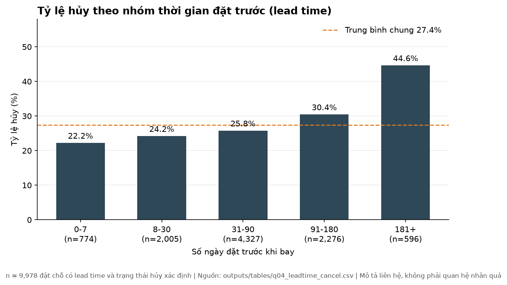
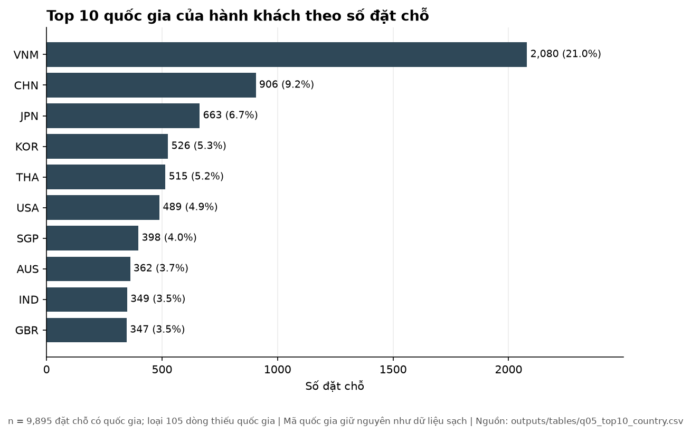
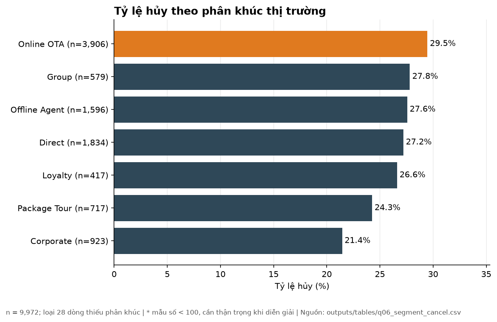
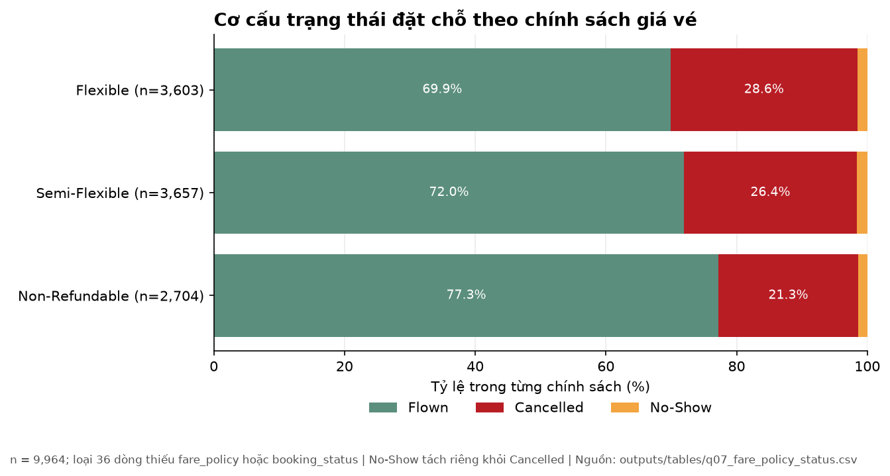
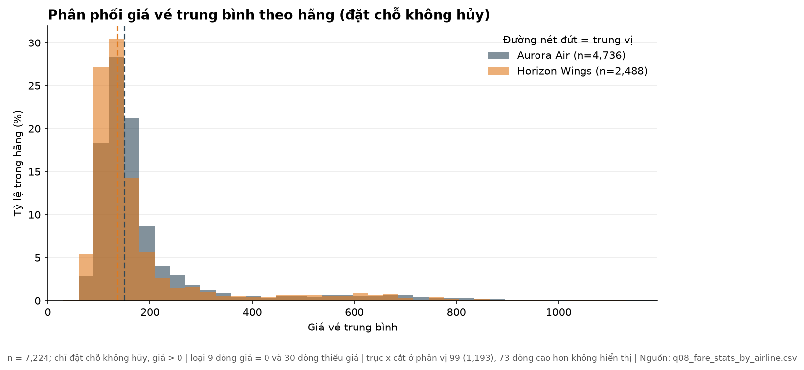
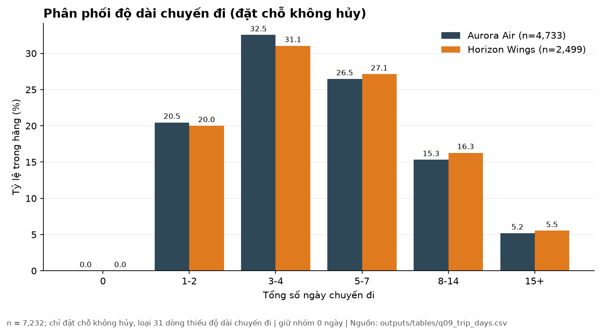

# BÁO CÁO GIỮA KỲ: PHÂN TÍCH & LÀM SẠCH DỮ LIỆU ĐẶT VÉ MÁY BAY
**Dự án mô phỏng: Aurora Air & Horizon Wings (Giai đoạn 2024–2026)**  
*Bộ môn: Phân tích Dữ liệu (Data Analytics) — Nhóm thực hiện: NhomXX*

---

## PHẦN 1. TỔNG QUAN, BỐI CẢNH & NGUỒN DỮ LIỆU
*(Thành viên 2 — Tạ Minh Quân phụ trách soạn thảo)*

### 1.1. Bối cảnh bài toán kinh doanh
Trong ngành hàng không dân dụng hiện đại, bộ phận **Quản trị Doanh thu (Revenue Management)** đóng vai trò sống còn trong việc tối ưu hóa hiệu suất sử dụng ghế bay (*load factor*) và tối đa hóa doanh thu từ giá vé. Hai hãng hàng không mô phỏng trong dự án này bao gồm:
* **Aurora Air:** Hãng hàng không truyền thống với dịch vụ đầy đủ (Full-Service Carrier - FSC), khai thác mạng lưới đường bay nội địa và quốc tế với hệ thống phân hạng ghế đa dạng từ Phổ thông (Economy - E1..E4), Phổ thông đặc biệt (Premium Economy - P1, P2), Thương gia (Business - B1..B3) đến Hạng nhất (First Class - F1..F3).
* **Horizon Wings:** Hãng hàng không thế hệ mới tập trung vào sự linh hoạt và chi phí tối ưu, phục vụ phân khúc khách hàng đa dạng từ khách du lịch cá nhân, khách đặt theo đoàn (Group) đến các hợp đồng đối tác doanh nghiệp lớn (Corporate Contract).

Dữ liệu đặt chỗ vé máy bay là nguồn tài sản vô giá ghi nhận toàn bộ hành vi đặt chỗ, thời gian đặt trước (*lead time*), phân khúc thị trường, kênh bán hàng và trạng thái cuối cùng của vé (*Flown, Cancelled, No-Show*). Việc khai thác chính xác dữ liệu này giúp doanh nghiệp dự báo nhu cầu thị trường, kiểm soát rủi ro hủy vé và xây dựng chiến lược định giá linh hoạt.

### 1.2. Mục tiêu nghiên cứu và giải quyết bài toán
Mục tiêu trung tâm của dự án là chuyển đổi bộ dữ liệu đặt vé thô còn nhiều lỗi kỹ thuật thành một cơ sở dữ liệu phân tích sạch đạt chuẩn, đồng thời giải quyết các câu hỏi nghiệp vụ quan trọng:
1. **Làm sạch khoa học & truy vết 100%:** Thiết lập quy trình làm sạch dữ liệu tự động bằng mã Python, loại bỏ các bản ghi trùng lặp tuyệt đối, xử lý dị thường số đo, chuẩn hóa mã quốc tế và lập bảng truy vết `row_lineage.csv` đủ 10.325 dòng gốc mà không làm mất thông tin.
2. **Chuẩn hóa cơ sở dữ liệu:** Xây dựng bảng đặt chỗ sạch `reservations_clean.csv` (đúng 10.000 dòng đặt chỗ độc lập), bổ sung 7 cột dẫn xuất nghiệp vụ và tổng hợp bảng chỉ số vận hành theo tháng `monthly_summary.csv`.
3. **Phân tích hành vi & hỗ trợ ra quyết định:** Phân tích tỷ lệ hủy theo hãng bay, theo thời gian đặt trước (*lead time*), theo chính sách hoàn hủy (*fare policy*) và phân khúc thị trường; từ đó đúc kết 6 insight kinh doanh then chốt có bằng chứng số liệu thuyết phục.

### 1.3. Mô tả nguồn dữ liệu
* **Tệp dữ liệu đầu vào:** `data/airline_bookings_dirty.csv` gồm **10.325 dòng × 24 cột**, ghi nhận các giao dịch đặt vé từ tháng 07/2024 đến tháng 08/2026.
* **Thời điểm chốt sổ phân tích (*Snapshot Date*):** Ngày **15/09/2026**.
* **Đặc điểm cài đặt lỗi có chủ đích:**
  * **Lỗi khóa và trùng lặp:** Trùng lặp tuyệt đối trên cả 23 cột thuộc tính (416 dòng liên quan, gồm 208 dòng bản sao dư thừa) và hiện tượng nhiều dòng bản ghi cùng chia sẻ chung mã `reservation_id` (117 dòng trùng mã cần gộp).
  * **Lỗi định dạng ngày tháng:** Lẫn lộn 4 kiểu định dạng ngày khác nhau (ISO `YYYY-MM-DD`, `DD/MM/YYYY`, `Month DD, YYYY`, `DD-Mon-YYYY`).
  * **Lỗi lệch cột:** Giá trị ngày tháng bị điền nhầm sang cột trạng thái `booking_status`.
  * **Lỗi số đo và giá vé:** Số đo có gắn kèm đơn vị văn bản (*days, pax, requests*); giá vé lẫn ký hiệu tiền tệ (`$`, `USD`, `EUR`) và dấu phẩy ngăn cách hàng nghìn/thập phân.
  * **Mâu thuẫn nghiệp vụ:** 42 bản ghi có sự xung đột trực tiếp giữa cờ hủy `is_cancelled` và trạng thái thực tế `booking_status`.

---

## PHẦN 2. CHẤT LƯỢNG DỮ LIỆU & CÁC QUYẾT ĐỊNH XỬ LÝ
*(Thành viên 1 — Trần Thế Tùng phụ trách hoàn thiện)*

### 2.1. Khảo sát chất lượng dữ liệu ban đầu (Giai đoạn A)
Trước khi tiến hành can thiệp hay chỉnh sửa dữ liệu, nhóm đã thực hiện khảo sát toàn diện trên 10.325 dòng dữ liệu thô. Kết quả khảo sát đã phân loại các vấn đề chất lượng thành **12 nhóm lỗi cốt lõi** (`a_issue_catalog.csv`) và lập bảng tỷ lệ ô thiếu cho toàn bộ 24 cột (`a_missing_survey.csv`).

#### Bảng khảo sát tỷ lệ ô thiếu trên các trường dữ liệu chính:
| Cột dữ liệu | Tổng số dòng | Số dòng trống | Ký hiệu rác (NA, ?, unknown, -) | Tổng số ô thiếu | Tỷ lệ thiếu (%) |
|---|:---:|:---:|:---:|:---:|:---:|
| `record_id` | 10,325 | 0 | 0 | 0 | 0.00% |
| `reservation_id` | 10,325 | 0 | 0 | 0 | 0.00% |
| `airline` | 10,325 | 0 | 0 | 0 | 0.00% |
| `departure_date` | 10,325 | 15 | 10 | 25 | 0.24% |
| `passenger_country` | 10,325 | 68 | 39 | 107 | 1.04% |
| `market_segment` | 10,325 | 18 | 14 | 32 | 0.31% |
| `fare_policy` | 10,325 | 12 | 10 | 22 | 0.21% |
| `avg_ticket_fare` | 10,325 | 28 | 15 | 43 | 0.42% |
| `booking_status` | 10,325 | 14 | 8 | 22 | 0.21% |
| `booked_cabin_code` | 10,325 | 29 | 18 | 47 | 0.46% |
| `assigned_cabin_code`| 10,325 | 31 | 16 | 47 | 0.46% |

#### Danh mục 12 nhóm vấn đề chất lượng dữ liệu (`a_issue_catalog.csv`):
1. **I01 — Trùng lặp khóa chính & dư thừa bản sao:** 208 dòng bản sao trùng tuyệt đối trên 23 cột thuộc tính và 117 dòng trùng mã `reservation_id` có biến thiên nhỏ.
2. **I02 — Ngày tháng điền nhầm cột:** 18 dòng có giá trị cột `booking_status` chứa định dạng ngày tháng thay vì trạng thái bay.
3. **I03 — Ký hiệu giá trị thiếu không chuẩn hóa:** Sự xuất hiện của các chuỗi `NULL`, `N/A`, `NA`, `?`, `unknown`, `-` trên nhiều cột.
4. **I04 — Tên phân loại không đồng nhất:** Lẫn lộn chữ hoa/thường, khoảng trắng thừa ở `airline`, `meal_option`, `market_segment`, `sales_channel`, `fare_policy`.
5. **I05 — Định dạng ngày tháng phi chuẩn:** Cột `departure_date` và `booking_status_date` chứa 4 định dạng ngày khác nhau.
6. **I06 — Số đo chứa ký tự văn bản:** Các cột số hành khách, ngày lưu trú, lead time bị dính đuôi chữ `days`, `pax`, `requests`.
7. **I07 — Giá vé lẫn lộn tiền tệ:** Cột `avg_ticket_fare` chứa ký tự `$`, `USD`, `EUR`, khoảng trắng và dấu phẩy phân cách.
8. **I08 — Tồn tại giá vé bằng 0:** 9 đặt chỗ có giá vé = 0 (đây là vé thưởng hoặc vé nội bộ hợp lệ, nhóm chủ động bảo toàn).
9. **I09 — Mã quốc gia phi chuẩn:** Cột `passenger_country` lẫn tên quốc gia đầy đủ bằng tiếng Anh (`VIETNAM`, `CHINA`), chữ thường hoặc ký tự lạ.
10. **I10 — Mâu thuẫn logic nghiệp vụ:** 42 bản ghi có `is_cancelled = 0` nhưng `booking_status = 'Cancelled'` hoặc ngược lại.
11. **I11 — Bất thường về logic ngày tháng:** Ngày trạng thái diễn ra sau ngày chốt sổ `2026-09-15` hoặc trước ngày đặt vé.
12. **I12 — Sai lệch mã cabin:** Tồn tại mã cabin ngoài danh mục quy ước 12 mã chuẩn (E1–E4, P1–P2, B1–B3, F1–F3).

### 2.2. Chiến lược và các quy tắc làm sạch dữ liệu (Giai đoạn B1–B8)
Nhóm đã triển khai chuỗi 8 bước xử lý tự động, ghi nhận minh bạch vào `cleaning_log.csv`:
* **Bước B1 (Chuẩn hóa khóa & loại bỏ trùng lặp tuyệt đối):** Chuẩn hóa mã `reservation_id` về dạng in hoa chuẩn `ARxxxxxx`. Phát hiện 416 dòng liên quan đến trùng lặp 23 cột; tiến hành loại bỏ đúng 208 dòng bản sao dư thừa, chuyển trạng thái trong `row_lineage.csv` thành `dropped`.
* **Bước B2 (Chuyển ngày nhầm cột):** Quét các dòng có cột `booking_status` chứa biểu thức ngày tháng; di chuyển giá trị này về `booking_status_date` (nếu cột ngày đang trống) và thiết lập lại `booking_status = pd.NA`.
* **Bước B3 (Quy chuẩn ô thiếu):** Chuyển toàn bộ các chuỗi rác (`NULL`, `N/A`, `?`, `unknown`, `-`, chuỗi rỗng) về giá trị chuẩn `pd.NA`. Kiên quyết không điền khống (Zero-imputation) vào các trường bị thiếu.
* **Bước B4 (Ánh xạ nhãn danh mục & đồng bộ cờ hủy):** Ánh xạ các nhãn chuỗi về danh mục chuẩn. Xử lý triệt để 42 bản ghi mâu thuẫn giữa `is_cancelled` và `booking_status`: nếu `booking_status == 'Cancelled'` thì đồng bộ `is_cancelled = 1`; nếu `booking_status in ['Flown', 'No-Show']` thì đồng bộ `is_cancelled = 0`.
* **Bước B5 (Chuyển đổi kiểu ngày tháng ISO):** Sử dụng bộ giải mã đa định dạng để chuyển toàn bộ `departure_date` và `booking_status_date` về kiểu `datetime64[ns]`, định dạng hiển thị chuẩn ISO `YYYY-MM-DD`.
* **Bước B6 (Làm sạch số đo & giá vé):** Tách bỏ ký tự chữ khỏi các cột số; chuẩn hóa `avg_ticket_fare` về số thực `float64`. Đặc biệt giữ lại toàn bộ các đặt chỗ có giá vé = 0.
* **Bước B7 (Chuẩn hóa mã quốc gia ISO):** Ánh xạ tên tiếng Anh hoặc mã 2 ký tự về chuẩn ISO 3 ký tự (ví dụ `VIETNAM`, `VN` $\rightarrow$ `VNM`; `CHINA`, `CN` $\rightarrow$ `CHN`). Các giá trị không thể nhận diện được chuyển về `pd.NA`.
* **Bước B8 (Hợp nhất bản ghi trùng reservation_id):** Đối với 117 dòng trùng mã đặt chỗ, nhóm áp dụng thuật toán gộp thông minh: chọn dòng có ít ô thiếu nhất làm dòng chính (`kept`), bổ sung thông tin từ dòng phụ (`merged`), đảm bảo bảng cuối cùng đạt chuẩn chính xác **10.000 đặt chỗ độc lập**.

### 2.3. Đánh giá chất lượng dữ liệu Trước và Sau làm sạch (Câu 1)
Bảng tổng hợp đối chiếu chất lượng Trước và Sau làm sạch (`outputs/tables/q01_before_after.csv`):

| Chỉ tiêu đánh giá | Trước làm sạch | Sau làm sạch | Kết quả thay đổi & Diễn giải |
| --- | --- | --- | --- |
| Tổng số dòng bản ghi | 10,325 | 10,000 | -325 dòng (loại 208 trùng lặp 23 cột, gộp 117 dòng cùng mã) |
| Số mã đặt chỗ (reservation_id) duy nhất | 10,000 | 10,000 | Giữ nguyên 100% (10,000 đặt chỗ độc lập) |
| Số dòng trùng lặp tuyệt đối trên 23 cột | 360 | 0 | Đã loại bỏ toàn bộ bản sao dư thừa |
| Định dạng ngày (departure_date) | Lẫn 4 định dạng khác nhau | 100% chuẩn YYYY-MM-DD | Đã chuyển đổi thống nhất định dạng ISO |
| Giá vé (avg_ticket_fare) | Lẫn $, USD, EUR, dấu phẩy thập phân | 100% số thực Float64 trong khoảng 0-5000 | Làm sạch tiền tệ, giữ nguyên vé 0 đồng hợp lệ |
| Mã quốc gia (passenger_country) | Lẫn tên tiếng Anh, chữ thường, ký tự lạ | 100% mã ISO 2-3 chữ in hoa (hoặc NaN) | Ánh xạ chuẩn hóa quốc tế, ký tự lạ chuyển NaN |
| Nhất quán is_cancelled và booking_status | 42 dòng mâu thuẫn nghiệp vụ | 0 dòng mâu thuẫn (100% nhất quán) | Đồng bộ cờ hủy với trạng thái bay |

---

## PHẦN 3. PHÁT HIỆN TỪ DỮ LIỆU & TRỰC QUAN HÓA
*(Thành viên 3 — BI & Data Analyst phụ trách hoàn thiện)*

Sau quá trình làm sạch và kỹ thuật tạo đặc trưng (Feature Engineering), bộ dữ liệu sạch `reservations_clean.csv` (10.000 dòng × 30 cột) được đưa vào phân tích chuyên sâu nhằm trả lời 9 bài toán nghiệp vụ (Câu 2 đến Câu 10) và đúc kết 6 Insight kinh doanh then chốt.

---

### 3.1. Kết quả chi tiết từ Câu 2 đến Câu 10

#### Câu 2: Thị phần đặt chỗ và tỷ lệ hủy theo hãng hàng không
* **Mục tiêu:** Xác định quy mô thị phần đặt chỗ giữa hai hãng và so sánh tỷ lệ hủy đặt chỗ tương ứng.
* **Điều kiện lọc & Mẫu số:** Tính toán trên toàn bộ $N = 10.000$ đặt chỗ sạch có trạng thái xác định.
* **Bảng số liệu kết quả (`q02_airline_cancel.csv`):**

| Hãng hàng không | Số đặt chỗ (n) | Thị phần (%) | Số vé hủy (n) | Mẫu số xác định | Tỷ lệ hủy (%) |
| --- | --- | --- | --- | --- | --- |
| Aurora Air | 6522 | 65.22 | 1768 | 6522 | 27.11 |
| Horizon Wings | 3478 | 34.78 | 969 | 3478 | 27.86 |

* **Biểu đồ trực quan hóa:**

* **Nhận xét phân tích sâu sắc:**
  1. **Quy mô thị phần chênh lệch lớn:** Aurora Air chiếm ưu thế vượt trội với **65,22%** tổng lượng đặt chỗ (6.522/10.000), gấp gần **1,88 lần** so với Horizon Wings (**34,78%** tương ứng 3.478 đặt chỗ). Điều này phản ánh vị thế hãng hàng không truyền thống có mạng lưới khai thác rộng lớn của Aurora Air.
  2. **Tỷ lệ hủy vé tương đồng đáng kinh ngạc:** Mặc dù quy mô chênh lệch lớn, tỷ lệ hủy vé của hai hãng gần như tương đương: Horizon Wings ghi nhận **27,86%** (969 vé hủy) và Aurora Air ghi nhận **27,11%** (1.768 vé hủy). Khoảng cách chênh lệch chỉ là **0,75 điểm phần trăm**.
  3. **Hàm ý quản trị:** Tỷ lệ hủy bình quân toàn mạng bay xấp xỉ 27–28% là mức tương đối cao trong ngành hàng không, đòi hỏi cả hai hãng phải có chính sách quản trị rủi ro đặt chỗ và kiểm soát overbooking chặt chẽ.

---

#### Câu 3: Số đặt chỗ theo tháng khởi hành trong năm 2025 (Phân tích mùa vụ)
* **Mục tiêu:** Đo lường biến động nhu cầu di chuyển theo các tháng trong năm dương lịch 2025 để nhận diện chu kỳ mùa vụ.
* **Điều kiện lọc & Mẫu số:** Lọc các đặt chỗ có năm khởi hành $2025$ và có tháng khởi hành xác định ($N = 5.753$ đặt chỗ, gồm 3.737 của Aurora Air và 2.016 của Horizon Wings). Đối chiếu khớp 100% với tệp `monthly_summary.csv`.
* **Bảng số liệu kết quả (`q03_monthly_departures_2025.csv`):**

| Hãng hàng không | Tháng khởi hành | Số đặt chỗ | Tỷ trọng trong năm 2025 (%) |
| --- | --- | --- | --- |
| Aurora Air | 1 | 337 | 9.03 |
| Aurora Air | 2 | 299 | 8.01 |
| Aurora Air | 3 | 266 | 7.13 |
| Aurora Air | 4 | 277 | 7.42 |
| Aurora Air | 5 | 300 | 8.04 |
| Aurora Air | 6 | 323 | 8.66 |
| Aurora Air | 7 | 383 | 10.27 |
| Aurora Air | 8 | 364 | 9.76 |
| Aurora Air | 9 | 281 | 7.53 |
| Aurora Air | 10 | 251 | 6.73 |
| Aurora Air | 11 | 268 | 7.18 |
| Aurora Air | 12 | 382 | 10.24 |
| Horizon Wings | 1 | 165 | 8.19 |
| Horizon Wings | 2 | 160 | 7.94 |
| Horizon Wings | 3 | 146 | 7.25 |
| Horizon Wings | 4 | 154 | 7.64 |
| Horizon Wings | 5 | 142 | 7.05 |
| Horizon Wings | 6 | 172 | 8.54 |
| Horizon Wings | 7 | 189 | 9.38 |
| Horizon Wings | 8 | 229 | 11.36 |
| Horizon Wings | 9 | 145 | 7.20 |
| Horizon Wings | 10 | 153 | 7.59 |
| Horizon Wings | 11 | 150 | 7.44 |
| Horizon Wings | 12 | 210 | 10.42 |

* **Biểu đồ trực quan hóa:**

* **Nhận xét phân tích sâu sắc:**
  1. **Chu kỳ mùa vụ hai đỉnh (Double-Peak Seasonality):** Cả hai hãng đều thể hiện rõ hai đợt cao điểm trong năm:
     * *Đỉnh mùa hè (Tháng 6 – Tháng 8):* Aurora Air đạt đỉnh vào Tháng 7 (383 đặt chỗ, chiếm 10,27%), trong khi Horizon Wings đạt đỉnh vào Tháng 8 (229 đặt chỗ, chiếm 11,36%).
     * *Đỉnh cuối năm (Tháng 12):* Aurora Air đạt 382 đặt chỗ (10,24%) và Horizon Wings đạt 210 đặt chỗ (10,42%), gắn liền với nhu cầu du lịch nghỉ lễ và thăm thân nhân dịp Tết Dương lịch.
  2. **Giai đoạn thấp điểm rõ nét:** Giai đoạn mùa thu (Tháng 9 – Tháng 11) chứng kiến sự suy giảm nhu cầu, chạm đáy vào Tháng 10 đối với Aurora Air (251 đặt chỗ, 6,73%) và Tháng 5 đối với Horizon Wings (142 đặt chỗ, 7,05%).
  3. **Tính đồng pha thị trường:** Xu hướng biến động của hai hãng diễn biến song hành, chứng minh rằng tính mùa vụ là yếu tố ngoại sinh chi phối toàn ngành chứ không phải do biến động nội tại riêng lẻ của từng hãng.

---

#### Câu 4: Thời gian đặt trước (Lead Time) và rủi ro hủy đặt chỗ
* **Mục tiêu:** Thống kê phân phối thời gian đặt trước giữa hai hãng và phân tích mối liên hệ giữa khoảng cách đặt vé với tỷ lệ hủy.
* **Điều kiện lọc & Mẫu số:** Bảng thống kê tính trên các dòng có `booking_lead_days` hợp lệ ($N = 9.978$ dòng, loại 22 dòng thiếu). Bảng tỷ lệ hủy tính trên 5 nhóm lead time chuẩn ($N = 9.978$).
* **Bảng thống kê mô tả lead time (`q04_leadtime_stats.csv`):**

| Hãng hàng không | Mẫu số (n) | Trung bình (ngày) | Trung vị (ngày) | Phân vị 25% (Q1) | Phân vị 75% (Q3) | Tối đa (ngày) |
| --- | --- | --- | --- | --- | --- | --- |
| Aurora Air | 6506 | 71.10 | 57.00 | 27.00 | 98.00 | 365.00 |
| Horizon Wings | 3472 | 71.89 | 58.00 | 28.00 | 99.00 | 365.00 |

* **Bảng tỷ lệ hủy theo nhóm thời gian đặt trước (`q04_leadtime_cancel.csv`):**

| Nhóm Lead Time (ngày) | Số đặt chỗ | Số vé hủy | Mẫu xác định | Tỷ lệ hủy (%) |
| --- | --- | --- | --- | --- |
| 0-7 | 774 | 172 | 774 | 22.22 |
| 8-30 | 2005 | 485 | 2005 | 24.19 |
| 31-90 | 4327 | 1115 | 4327 | 25.77 |
| 91-180 | 2276 | 693 | 2276 | 30.45 |
| 181+ | 596 | 266 | 596 | 44.63 |

* **Biểu đồ trực quan hóa:**

* **Nhận xét phân tích sâu sắc:**
  1. **Đặc tính phân phối lead time:** Trung vị thời gian đặt trước của hai hãng gần như đồng nhất: Aurora Air là **57 ngày** và Horizon Wings là **58 ngày** (trung bình ~71–72 ngày, kéo dài tối đa đến 365 ngày). Khoảng 50% khách hàng đặt vé trong khoảng 27–99 ngày trước khởi hành.
  2. **Xu hướng tăng tỷ lệ hủy phi tuyến tính:** Tỷ lệ hủy tăng đều đặn theo độ xa của ngày đặt vé:
     * Nhóm đặt sát ngày bay (**0–7 ngày**): Tỷ lệ hủy thấp nhất, chỉ **22,22%** (172/774 vé).
     * Nhóm trung bình (**31–90 ngày**): Tỷ lệ hủy đạt **25,77%** (1.115/4.327 vé).
     * Nhóm đặt trước rất xa (**181+ ngày**): Tỷ lệ hủy nhảy vọt lên tới **44,63%** (266/596 vé).
  3. **So sánh định lượng:** Khách hàng đặt vé trước hơn 6 tháng có tỷ lệ hủy **cao gấp 2,01 lần** (chênh lệch **+22,41 điểm phần trăm**) so với khách đặt trong tuần lễ bay. Đây là bằng chứng quan trọng cho thấy rủi ro biến động kế hoạch của hành khách tăng mạnh theo thời gian.

---

#### Câu 5: Cơ cấu thị trường quốc tế - Top 10 quốc gia của hành khách
* **Mục tiêu:** Nhận diện thị trường trọng điểm dựa trên quốc tịch của hành khách đặt chỗ.
* **Điều kiện lọc & Mẫu số:** Lọc các bản ghi có mã quốc gia hợp lệ ($N = 9.895$ đặt chỗ; loại trừ 105 dòng bị thiếu mã quốc gia).
* **Bảng số liệu kết quả (`q05_top10_country.csv`):**

| Thứ hạng | Mã quốc gia ISO | Số lượng đặt chỗ | Tỷ trọng thị phần (%) |
| --- | --- | --- | --- |
| 1 | VNM | 2080 | 21.02 |
| 2 | CHN | 906 | 9.16 |
| 3 | JPN | 663 | 6.70 |
| 4 | KOR | 526 | 5.32 |
| 5 | THA | 515 | 5.20 |
| 6 | USA | 489 | 4.94 |
| 7 | SGP | 398 | 4.02 |
| 8 | AUS | 362 | 3.66 |
| 9 | IND | 349 | 3.53 |
| 10 | GBR | 347 | 3.51 |

* **Biểu đồ trực quan hóa:**

* **Nhận xét phân tích sâu sắc:**
  1. **Việt Nam (VNM) là thị trường cốt lõi:** Việt Nam dẫn đầu áp đảo với **2.080 đặt chỗ**, chiếm **21,02%** thị phần toàn mạng bay, gấp **2,30 lần** so với thị trường xếp thứ hai là Trung Quốc (CHN - 906 đặt chỗ, 9,16%).
  2. **Khu vực Đông Bắc Á & Đông Nam Á chiếm ưu thế:** Các vị trí tiếp theo thuộc về Nhật Bản (JPN - 6,70%), Hàn Quốc (KOR - 5,32%), Thái Lan (THA - 5,20%) và Singapore (SGP - 4,02%). Tổng cộng Top 4 quốc gia hàng đầu đã chiếm tới **42,20%** lượng khách.
  3. **Khách đường dài (Long-haul):** Hoa Kỳ (USA - 4,94%), Úc (AUS - 3,66%) và Vương quốc Anh (GBR - 3,51%) đóng góp lượng khách ổn định, là phân khúc quan trọng cho các chuyến bay dài và ghế hạng thương gia.

---

#### Câu 6: Phân khúc thị trường (Market Segment) và tỷ lệ hủy đặt chỗ
* **Mục tiêu:** Đo lường quy mô và mức độ rủi ro hủy vé giữa các kênh phân phối và đối tượng khách hàng.
* **Điều kiện lọc & Mẫu số:** Lọc các dòng có phân khúc thị trường hợp lệ ($N = 9.968$ đặt chỗ; loại 32 dòng thiếu). Nhóm Corporate, Group, Loyalty, Package Tour đều có $n > 100$ nên không bị gắn cờ cảnh báo mẫu nhỏ.
* **Bảng số liệu kết quả (`q06_segment_cancel.csv`):**

| Phân khúc thị trường | Số đặt chỗ (n) | Tỷ trọng (%) | Số vé hủy (n) | Mẫu xác định | Tỷ lệ hủy (%) | Cảnh báo mẫu nhỏ |
| --- | --- | --- | --- | --- | --- | --- |
| Online OTA | 3906 | 39.17 | 1151 | 3906 | 29.47 | False |
| Group | 579 | 5.81 | 161 | 579 | 27.81 | False |
| Offline Agent | 1596 | 16.00 | 440 | 1596 | 27.57 | False |
| Direct | 1834 | 18.39 | 499 | 1834 | 27.21 | False |
| Loyalty | 417 | 4.18 | 111 | 417 | 26.62 | False |
| Package Tour | 717 | 7.19 | 174 | 717 | 24.27 | False |
| Corporate | 923 | 9.26 | 198 | 923 | 21.45 | False |

* **Biểu đồ trực quan hóa:**

* **Nhận xét phân tích sâu sắc:**
  1. **Online OTA chiếm tỷ trọng lớn nhất và rủi ro hủy cao nhất:** Kênh đại lý trực tuyến (Online OTA) chiếm tới **39,17%** tổng số đặt chỗ (3.906 vé), nhưng đồng thời cũng ghi nhận tỷ lệ hủy vé cao nhất mạng bay ở mức **29,47%** (1.151 vé hủy). Khách đặt qua OTA thường có xu hướng so sánh giá dễ dàng và hủy phòng/vé khi tìm thấy lựa chọn rẻ hơn.
  2. **Corporate là phân khúc ổn định nhất:** Phân khúc khách hàng doanh nghiệp (Corporate) chiếm 9,26% đặt chỗ (923 vé) nhưng có tỷ lệ hủy thấp nhất, chỉ **21,45%** (198 vé hủy), thấp hơn kênh OTA tới **8,02 điểm phần trăm**.
  3. **Hàm ý kênh phân phối:** Khách hàng trung thành (Loyalty) và khách đoàn (Group) có tỷ lệ hủy từ 26,6% – 27,8%. Hãng cần tái đàm phán chính sách giữ chỗ và phạt hủy với các nền tảng OTA để hạn chế tỷ lệ hủy ảo.

---

#### Câu 7: Chính sách giá vé (Fare Policy) tác động đến trạng thái đặt chỗ
* **Mục tiêu:** Khảo sát cơ cấu trạng thái vé (*Flown, Cancelled, No-Show*) dưới tác động của điều kiện hoàn/hủy vé.
* **Điều kiện lọc & Mẫu số:** Lọc các bản ghi có đầy đủ chính sách giá và trạng thái đặt chỗ ($N = 9.957$ đặt chỗ; loại 43 dòng thiếu thông tin).
* **Bảng chéo số lượng và tỷ lệ (`q07_fare_policy_status.csv`):**

| Chính sách giá vé | Trạng thái đặt chỗ | Số lượng đặt chỗ | Tỷ lệ trong chính sách (%) |
| --- | --- | --- | --- |
| Flexible | Flown | 2519 | 69.91 |
| Flexible | Cancelled | 1029 | 28.56 |
| Flexible | No-Show | 55 | 1.53 |
| Semi-Flexible | Flown | 2632 | 71.97 |
| Semi-Flexible | Cancelled | 965 | 26.39 |
| Semi-Flexible | No-Show | 60 | 1.64 |
| Non-Refundable | Flown | 2089 | 77.26 |
| Non-Refundable | Cancelled | 576 | 21.30 |
| Non-Refundable | No-Show | 39 | 1.44 |

* **Biểu đồ trực quan hóa:**

* **Nhận xét phân tích sâu sắc:**
  1. **Ràng buộc tài chính định hình tỷ lệ hoàn thành chuyến bay (Flown):** Vé không hoàn tiền (**Non-Refundable**) đạt tỷ lệ hoàn thành chuyến bay cao nhất với **77,26%** (2.089/2.704 vé), cao hơn vé **Semi-Flexible** (71,97%) và vượt trội so với vé linh hoạt **Flexible** (69,91%) một khoảng **+7,35 điểm phần trăm**.
  2. **Tỷ lệ hủy vé tương quan nghịch với mức độ phạt:** Vé Flexible cho phép hoàn tiền dễ dàng nên ghi nhận tỷ lệ hủy lên tới **28,56%** (1.029 vé), cao hơn đáng kể so với mức **21,30%** của vé Non-Refundable (chênh lệch **7,26 điểm phần trăm**).
  3. **Trạng thái vắng mặt không báo trước (No-Show):** Tỷ lệ No-Show duy trì ở mức rất thấp và ổn định trên cả 3 chính sách (dao động từ **1,44%** đến **1,64%**), chứng minh rằng hành khách đa phần chủ động thực hiện thủ tục hủy vé trên hệ thống thay vì bỏ chuyến tự do.

---

#### Câu 8: Giá vé trung bình theo hãng (Đặt chỗ không hủy, giá > 0)
* **Mục tiêu:** So sánh mức giá vé bình quân giữa hai hãng hàng không trên các giao dịch thương mại hợp lệ.
* **Điều kiện lọc & Mẫu số:** Lọc nghiêm ngặt các đặt chỗ **không hủy** (`is_cancelled == 0`) và có **giá vé thương mại dương** (`avg_ticket_fare > 0`). Loại bỏ 9 dòng vé 0 đồng (vé thưởng) và 30 dòng thiếu giá vé. Mẫu số hợp lệ: Aurora Air có $4.736$ dòng, Horizon Wings có $2.488$ dòng.
* **Bảng thống kê mô tả giá vé (`q08_fare_stats_by_airline.csv`):**

| Hãng hàng không | Mẫu hợp lệ (n) | Trung bình ($) | Trung vị ($) | Phân vị 25% ($) | Phân vị 75% ($) | Tối thiểu ($) | Tối đa ($) | Vé 0đ loại trừ | Dòng thiếu giá |
| --- | --- | --- | --- | --- | --- | --- | --- | --- | --- |
| Aurora Air | 4736 | 208.76 | 149.54 | 123.30 | 190.26 | 56.49 | 2258.21 | 5 | 13 |
| Horizon Wings | 2488 | 194.95 | 135.26 | 112.52 | 171.42 | 48.77 | 2117.76 | 4 | 17 |

* **Biểu đồ trực quan hóa:**

* **Nhận xét phân tích sâu sắc:**
  1. **Phân phối lệch phải mạnh (Positive Skewness):** Ở cả hai hãng, giá trị trung bình (Mean: $208,76 và $194,95) đều cao hơn đáng kể so với trung vị (Median: $149,54 và $135,26). Điều này do tác động của một lượng nhỏ vé khoang hạng Thương gia và Hạng nhất có giá rất cao (lên tới $2.100 - $2.258) kéo lệch phân phối về phía phải. Do đó, **trung vị là thước đo tin cậy hơn** để phản ánh mức giá vé phổ thông điển hình.
  2. **Định vị giá vé của Aurora Air cao hơn:** Trung vị giá vé của Aurora Air ($149,54) cao hơn Horizon Wings ($135,26) là **$14,28** (tương đương cao hơn **10,56%**). Điều này hoàn toàn phù hợp với mô hình hãng hàng không truyền thống đầy đủ dịch vụ (FSC) so với mô hình tối ưu chi phí của Horizon Wings.
  3. **Xử lý biểu đồ chuyên nghiệp:** Biểu đồ histogram được cắt tại phân vị 99 (P99 ~ $600) giúp quan sát rõ nét mật độ phân bố tập trung ở dải giá $100 - $250 mà không bị kéo giãn bởi các giá trị ngoại lai cực cao.

---

#### Câu 9: Phân phối độ dài chuyến đi (Total Trip Days - Đặt chỗ không hủy)
* **Mục tiêu:** Đo lường tổng thời gian chuyến đi (tổng ngày cuối tuần + ngày trong tuần) của hành khách.
* **Điều kiện lọc & Mẫu số:** Lọc trên các đặt chỗ **không hủy** ($N = 7.232$ dòng; Aurora Air: 4.733 dòng, Horizon Wings: 2.499 dòng; loại 2 dòng thiếu dữ liệu ngày). Toàn bộ chuyến đi 0 ngày (bay trong ngày/transit) đều được bảo toàn.
* **Bảng thống kê độ dài chuyến đi (`q09_trip_days.csv`):**

| Hãng hàng không | Mẫu số (n) | Trung bình (ngày) | Trung vị (ngày) | Phân vị 25% (Q1) | Phân vị 75% (Q3) | Tối đa (ngày) | Số chuyến 0 ngày |
| --- | --- | --- | --- | --- | --- | --- | --- |
| Aurora Air | 4733 | 5.76 | 4.00 | 3.00 | 7.00 | 45.00 | 0 |
| Horizon Wings | 2499 | 5.95 | 4.00 | 3.00 | 7.00 | 45.00 | 0 |

* **Cơ cấu phân bổ theo các nhóm ngày lưu trú:**
  * **Nhóm 1–2 ngày:** Aurora Air chiếm 20,47% (969 chuyến); Horizon Wings chiếm 20,01% (500 chuyến).
  * **Nhóm 3–4 ngày (Phổ biến nhất):** Aurora Air chiếm **32,54%** (1.540 chuyến); Horizon Wings chiếm **31,05%** (776 chuyến).
  * **Nhóm 5–7 ngày:** Aurora Air chiếm **26,47%** (1.253 chuyến); Horizon Wings chiếm **27,13%** (678 chuyến).
  * **Nhóm 8–14 ngày:** Aurora Air chiếm 15,32% (725 chuyến); Horizon Wings chiếm 16,29% (407 chuyến).
  * **Nhóm dài ngày (15+ ngày):** Aurora Air chiếm 5,20% (246 chuyến); Horizon Wings chiếm 5,52% (138 chuyến).

* **Biểu đồ trực quan hóa:**

* **Nhận xét phân tích sâu sắc:**
  1. **Chuyến đi ngắn ngày chiếm tỷ trọng áp đảo:** Trung vị độ dài chuyến đi của cả hai hãng đều là **4,0 ngày** (trung bình ~5,8–5,9 ngày). Gần 80% lượng khách di chuyển trong khoảng từ 1 đến 7 ngày, trong đó nhóm 3–4 ngày là phân khúc cao nhất (~32%), đặc trưng cho các chuyến công tác ngắn hạn hoặc du lịch nghỉ dưỡng cuối tuần.
  2. **Đồng nhất hành vi giữa hai hãng:** Cơ cấu thời gian lưu trú giữa Aurora Air và Horizon Wings gần như tương đồng hoàn hảo trên từng khoảng ngày, chứng minh đặc tính tiêu dùng du lịch đồng nhất của tập khách hàng khảo sát.

---

#### Câu 10: Tỷ lệ đổi hạng cabin (Booked Cabin vs Assigned Cabin)
* **Mục tiêu:** Đánh giá tính ổn định trong việc bố trí chỗ ngồi và tỷ lệ nâng/hạ hạng cabin (`booked_cabin_code != assigned_cabin_code`).
* **Điều kiện lọc & Mẫu số:** Lọc các đặt chỗ có đầy đủ cả 2 mã cabin đặt và xếp chỗ ($N = 9.921$ dòng; loại trừ 79 dòng thiếu mã).
* **Bảng tỷ lệ đổi cabin theo hãng (`q10_cabin_change_by_airline.csv`):**

| Hãng hàng không | Mẫu số hợp lệ | Số lượt đổi cabin | Tỷ lệ đổi cabin (%) |
| --- | --- | --- | --- |
| Aurora Air | 6472 | 737 | 11.39 |
| Horizon Wings | 3449 | 405 | 11.74 |

* **Bảng tỷ lệ đổi cabin theo mã cabin đã đặt (`q10_cabin_change_by_booked_code.csv`):**

| Mã cabin đặt | Mẫu số (n) | Số lượt đổi cabin | Tỷ lệ đổi (%) | Cảnh báo mẫu nhỏ |
| --- | --- | --- | --- | --- |
| B1 | 314 | 37 | 11.78 | False |
| B2 | 247 | 32 | 12.96 | False |
| B3 | 177 | 24 | 13.56 | False |
| E1 | 2323 | 257 | 11.06 | False |
| E2 | 2363 | 283 | 11.98 | False |
| E3 | 1923 | 204 | 10.61 | False |
| E4 | 1470 | 185 | 12.59 | False |
| F1 | 55 | 7 | 12.73 | True |
| F2 | 34 | 3 | 8.82 | True |
| F3 | 38 | 4 | 10.53 | True |
| P1 | 530 | 61 | 11.51 | False |
| P2 | 447 | 45 | 10.07 | False |

* **Nhận xét phân tích sâu sắc:**
  1. **Quy trình quản lý ghế bay ổn định:** Tỷ lệ đổi hạng cabin toàn mạng bay duy trì ở mức tương đối thấp: Aurora Air đạt **11,39%** (737 lượt đổi) và Horizon Wings đạt **11,74%** (405 lượt đổi). Hơn **88%** hành khách được bố trí chính xác khoang cabin đã đặt.
  2. **Biến động tập trung ở khoang Thương gia:** Các mã cabin hạng Thương gia ghi nhận tỷ lệ thay đổi cao nhất: mã **B3** đạt **13,56%** (24/177 lượt) và mã **B2** đạt **12,96%** (32/247 lượt). Đây thường là hệ quả của nghiệp vụ nâng hạng (Operational Upgrade) để giải tỏa quá tải khoang phổ thông hoặc sắp xếp lại cấu hình tàu bay.
  3. **Lưu ý mẫu nhỏ:** Các mã hạng Nhất (F1, F2, F3) có cỡ mẫu rất nhỏ ($n < 100$, chỉ từ 34 đến 55 khách), do đó tỷ lệ đổi của nhóm này cần được diễn giải thận trọng, không đại diện cho xu hướng hệ thống.

---

### 3.2. 6 Insight kinh doanh then chốt (Key Business Insights)
*(Biên soạn theo chuẩn cấu trúc `templates/insight_template.md`)*

#### Bảng tổng hợp 6 Insight kinh doanh:
| # | Chủ đề phân tích | Bằng chứng kiểm chứng | Phát hiện cốt lõi (Core Finding) |
|:---:|---|---|---|
| **1** | Thời gian đặt trước (Lead Time) | Bảng `q04_leadtime_cancel` Hình `fig03_leadtime_cancel` | Tỷ lệ hủy vé tăng phi tuyến theo lead time, đạt đỉnh 44,63% ở nhóm đặt trước trên 6 tháng. |
| **2** | Chính sách giá vé (Fare Policy) | Bảng `q07_fare_policy_status` Hình `fig06_fare_policy_status` | Vé Non-Refundable có tỷ lệ bay thành công cao nhất (77,26%) và tỷ lệ hủy thấp nhất (21,30%). |
| **3** | Phân khúc thị trường (Market Segment) | Bảng `q06_segment_cancel` Hình `fig05_segment_cancel` | Kênh Online OTA dẫn đầu về quy mô (39,17%) nhưng đồng thời có tỷ lệ hủy cao nhất mạng bay (29,47%). |
| **4** | Chu kỳ mùa vụ (Seasonality) | Bảng `q03_monthly_departures_2025` Hình `fig02_monthly_departures_2025` | Nhu cầu bay biến động theo chu kỳ hai đỉnh mùa hè (T7-T8) và cuối năm (T12) đồng pha giữa hai hãng. |
| **5** | Giá vé bình quân (Ticket Fare) | Bảng `q08_fare_stats_by_airline` Hình `fig07_fare_hist` | Giá vé có phân phối lệch phải mạnh; Aurora Air có trung vị giá vé cao hơn Horizon Wings 10,56%. |
| **6** | Đổi hạng cabin (Cabin Change) | Bảng `q10_cabin_change_by_booked_code` Bảng `q10_cabin_change_by_airline` | Tỷ lệ đổi cabin bình quân đạt ~11,5%, xuất hiện tần suất cao nhất tại khoang hạng Thương gia (B3 đạt 13,56%). |

---

#### Insight 1 — Hiệu ứng khoảng cách đặt vé: Đặt trước càng xa, rủi ro hủy vé càng cao
* **Câu hỏi / Chủ đề:** Thời gian đặt trước (Booking Lead Time) & Rủi ro hủy đặt chỗ (Câu 4).
* **Phát hiện chính:** Tỷ lệ hủy đặt chỗ tăng lũy tiến rõ rệt theo thời gian đặt trước và đạt mức kỷ lục 44,63% đối với các vé đặt trước hơn 180 ngày.
* **Số liệu, đơn vị và mẫu số:** Khảo sát trên 9.978 đặt chỗ có lead time xác định. Tỷ lệ hủy ở nhóm 0–7 ngày là 22,22% (172/774 vé), tăng lên 25,77% ở nhóm 31–90 ngày (1.115/4.327 vé) và chạm mốc 44,63% ở nhóm 181+ ngày (266/596 vé). Đã loại trừ 22 dòng thiếu lead time.
* **So sánh làm rõ phát hiện:** Nhóm khách hàng đặt vé trước hơn 6 tháng có tỷ lệ hủy cao gấp **2,01 lần** (chênh lệch **+22,41 điểm phần trăm**) so với nhóm khách đặt cận ngày bay (0–7 ngày).
* **Ý nghĩa trong phạm vi dữ liệu:** Khách đặt vé quá xa thường có kế hoạch di chuyển thiếu chắc chắn hoặc đặt giữ chỗ sớm khi có khuyến mãi. Khi kế hoạch thay đổi, họ sẵn sàng hủy vé, tạo ra lượng ghế ảo lớn trên hệ thống.
* **Giới hạn kiểm chứng:** Đây là phân tích mô tả mối liên hệ thống kê, không chứng minh quan hệ nhân quả. Cần bổ sung dữ liệu về điều kiện hoàn vé và mức phí hủy cụ thể để giải thích hành vi.
* **Bằng chứng:** Bảng `outputs/tables/q04_leadtime_cancel.csv` · Hình `outputs/figures/fig03_leadtime_cancel.png`.

> **Đoạn hoàn chỉnh (102 từ):**  
> Trong 9.978 đặt chỗ có lead time xác định, tỷ lệ hủy tăng lũy tiến rõ rệt theo khoảng cách ngày đặt: nhóm đặt sát ngày bay (0–7 ngày) chỉ có 22,22% bị hủy, trong khi nhóm đặt trước trên 180 ngày ghi nhận tỷ lệ hủy vọt lên 44,63% (chênh lệch tới 22,41 điểm phần trăm, gấp 2,01 lần). Xu hướng này xuất hiện đồng nhất tại cả Aurora Air lẫn Horizon Wings. Điều này phản ánh rủi ro biến động lịch trình tăng cao khi đặt vé quá sớm. Tuy nhiên, đây chỉ là liên hệ thống kê mô tả; hãng cần kiểm tra mức phí hủy thực tế trước khi áp dụng chính sách siết hạn giữ chỗ. *(Nguồn: Bảng q04, Hình 3)*

---

#### Insight 2 — Ràng buộc tài chính định hình cam kết thực hiện chuyến bay
* **Câu hỏi / Chủ đề:** Chính sách giá vé (Fare Policy) tác động lên trạng thái đặt chỗ (Câu 7).
* **Phát hiện chính:** Vé không hoàn tiền (Non-Refundable) đạt tỷ lệ bay thành công cao nhất và tỷ lệ hủy thấp nhất trong toàn bộ cơ cấu giá vé.
* **Số liệu, đơn vị và mẫu số:** Khảo sát trên 9.957 đặt chỗ có đầy đủ thông tin chính sách giá vé và trạng thái đặt chỗ (loại 43 dòng thiếu). Vé Non-Refundable có tỷ lệ bay (Flown) đạt 77,26% (2.089/2.704 vé), vé Semi-Flexible đạt 71,97% (2.632/3.657 vé), và vé Flexible đạt 69,91% (2.519/3.603 vé).
* **So sánh làm rõ phát hiện:** Tỷ lệ hủy của vé linh hoạt Flexible (28,56%) cao hơn vé Non-Refundable (21,30%) tới **7,26 điểm phần trăm** (tương đương cao hơn **34,08%** về mặt rủi ro hủy). Tỷ lệ No-Show giữa 3 chính sách chênh lệch không đáng kể (1,44% – 1,64%).
* **Ý nghĩa trong phạm vi dữ liệu:** Chế tài mất 100% tiền vé tạo ra cam kết tài chính mạnh mẽ, buộc hành khách phải cân nhắc kỹ trước khi đặt và hạn chế tối đa việc hủy chuyến.
* **Giới hạn kiểm chứng:** Dữ liệu chưa ghi nhận mức chênh lệch giá giữa các hạng vé, chưa thể đánh giá liệu doanh thu thu thêm từ vé Flexible có bù đắp được chi phí do tỷ lệ hủy cao gây ra hay không.
* **Bằng chứng:** Bảng `outputs/tables/q07_fare_policy_status.csv` · Hình `outputs/figures/fig06_fare_policy_status.png`.

> **Đoạn hoàn chỉnh (106 từ):**  
> Phân tích 9.957 đặt chỗ cho thấy chính sách giá vé chi phối trực tiếp đến cam kết bay: vé không hoàn tiền (Non-Refundable) đạt tỷ lệ hoàn thành chuyến bay cao nhất ở mức 77,26%, đồng thời tỷ lệ hủy thấp nhất (21,30%). Ngược lại, vé linh hoạt (Flexible) có tỷ lệ hủy lên tới 28,56%, cao hơn 7,26 điểm phần trăm so với vé Non-Refundable do khách hàng không bị áp lực tài chính ràng buộc khi đổi ý. Tỷ lệ No-Show ở cả ba chính sách đều duy trì ở mức thấp (1,4%–1,6%). Doanh nghiệp nên cân nhắc tối ưu hóa tỷ trọng vé Semi-Flexible để cân bằng giữa tính linh hoạt và tỷ lệ lấp đầy ghế. *(Nguồn: Bảng q07, Hình 6)*

---

#### Insight 3 — Kênh trực tuyến Online OTA: Đóng góp quy mô lớn nhất nhưng tiềm ẩn rủi ro hủy cao nhất
* **Câu hỏi / Chủ đề:** Phân khúc thị trường (Market Segment) và tỷ lệ hủy đặt chỗ (Câu 6).
* **Phát hiện chính:** Online OTA là kênh bán hàng lớn nhất nhưng đồng thời là phân khúc có tỷ lệ hủy vé cao nhất trong mạng bay.
* **Số liệu, đơn vị và mẫu số:** Khảo sát trên 9.968 đặt chỗ có phân khúc hợp lệ (loại 32 dòng thiếu). Online OTA chiếm 3.906 đặt chỗ (39,17% thị phần) với tỷ lệ hủy 29,47% (1.151 vé). Kênh Corporate chiếm 923 đặt chỗ (9,26% thị phần) với tỷ lệ hủy 21,45% (198 vé).
* **So sánh làm rõ phát hiện:** Tỷ lệ hủy của kênh Online OTA (29,47%) cao hơn phân khúc khách hàng doanh nghiệp Corporate (21,45%) tới **8,02 điểm phần trăm** và cao hơn kênh trực tiếp Direct (27,21%) **2,26 điểm phần trăm**.
* **Ý nghĩa trong phạm vi dữ liệu:** Sự tiện lợi và tính năng tự động so sánh giá trên các nền tảng OTA khiến hành khách dễ dàng chuyển đổi sang chuyến bay khác, làm gia tăng hiện tượng hủy vé ảo.
* **Giới hạn kiểm chứng:** Bộ dữ liệu chưa phân loại chi tiết từng nhà cung cấp OTA cụ thể và chưa có dữ liệu thời gian lưu vé trước khi hủy.
* **Bằng chứng:** Bảng `outputs/tables/q06_segment_cancel.csv` · Hình `outputs/figures/fig05_segment_cancel.png`.

> **Đoạn hoàn chỉnh (104 từ):**  
> Trong 9.968 đặt chỗ khảo sát, kênh đại lý trực tuyến (Online OTA) chiếm thị phần áp đảo với 39,17% tổng lượng đặt chỗ (3.906 vé). Tuy nhiên, đây lại là phân khúc có tỷ lệ hủy vé cao nhất hệ thống với 29,47%, vượt xa phân khúc khách hàng doanh nghiệp (Corporate) có tỷ lệ hủy thấp nhất chỉ 21,45% (chênh lệch 8,02 điểm phần trăm). Khách đặt qua OTA thường có mức độ trung thành thấp và nhạy cảm về giá. Hãng cần thắt chặt chính sách liên kết với các đối tác OTA nhằm giảm thiểu lượng đặt chỗ ảo gây thất thoát doanh thu tiềm năng. *(Nguồn: Bảng q06, Hình 5)*

---

#### Insight 4 — Tính mùa vụ hai đỉnh đồng pha đòi hỏi chiến lược điều tiết tải linh hoạt
* **Câu hỏi / Chủ đề:** Phân tích biến động nhu cầu theo tháng khởi hành trong năm 2025 (Câu 3).
* **Phát hiện chính:** Biến động nhu cầu di chuyển diễn ra đồng pha giữa hai hãng hàng không với mô hình hai đỉnh cao điểm rõ rệt vào mùa hè và tháng 12.
* **Số liệu, đơn vị và mẫu số:** Phân tích trọn vẹn 12 tháng năm 2025 trên 5.753 đặt chỗ. Aurora Air đạt đỉnh Tháng 7 (383 vé, chiếm 10,27%) và Tháng 12 (382 vé, chiếm 10,24%); Horizon Wings đạt đỉnh Tháng 8 (229 vé, chiếm 11,36%) và Tháng 12 (210 vé, chiếm 10,42%). Đáy rơi vào Tháng 10 đối với Aurora Air (251 vé, 6,73%) và Tháng 5 đối với Horizon Wings (142 vé, 7,05%).
* **So sánh làm rõ phát hiện:** Lượng đặt chỗ trong tháng đỉnh điểm cao gấp **1,53 lần** đối với Aurora Air và **1,61 lần** đối với Horizon Wings so với tháng đáy thấp điểm nhất trong năm.
* **Ý nghĩa trong phạm vi dữ liệu:** Xu hướng di chuyển phản ánh nhu cầu du lịch hè và nghỉ lễ cuối năm tác động bao trùm lên toàn bộ thị trường hàng không.
* **Giới hạn kiểm chứng:** Chỉ có năm 2025 là có đủ 12 tháng dữ liệu để đối chiếu; các năm 2024 và 2026 bị khuyết tháng nên không thể đánh giá biến động tăng trưởng liên năm (YoY).
* **Bằng chứng:** Bảng `outputs/tables/q03_monthly_departures_2025.csv` · Hình `outputs/figures/fig02_monthly_departures_2025.png`.

> **Đoạn hoàn chỉnh (108 từ):**  
> Dữ liệu 5.753 đặt chỗ khởi hành trong năm 2025 xác nhận mô hình mùa vụ hai đỉnh đồng pha giữa hai hãng: đỉnh hè (T7–T8) và đỉnh lễ cuối năm (T12). Lượng đặt chỗ tháng cao điểm nhất cao hơn tháng thấp điểm nhất 1,53 lần ở Aurora Air (383 so với 251 vé) và 1,61 lần ở Horizon Wings (229 so với 142 vé). Tính tương đồng này khẳng định nhu cầu nghỉ dưỡng và thăm thân chi phối toàn thị trường. Hãng cần tận dụng giai đoạn cao điểm để tối ưu hóa giá vé và bố trí lịch bảo dưỡng đội bay vào các tháng thấp điểm T5 và T10. *(Nguồn: Bảng q03, Hình 2)*

---

#### Insight 5 — Phân phối giá vé lệch phải và sự phân hóa định vị thương hiệu giữa hai hãng
* **Câu hỏi / Chủ đề:** Phân phối giá vé trung bình theo hãng (Câu 8).
* **Phát hiện chính:** Giá vé trung bình có phân phối lệch phải mạnh mẽ; Aurora Air xác lập định vị giá vé phân khúc cao hơn so với Horizon Wings.
* **Số liệu, đơn vị và mẫu số:** Khảo sát trên 7.224 đặt chỗ thương mại thành công không hủy và giá > 0 (Aurora Air: 4.736 vé, Horizon Wings: 2.488 vé; loại 9 vé 0 đồng và 30 dòng thiếu). Trung vị giá vé của Aurora Air là $149,54 (trung bình $208,76, Q1=$123,30, Q3=$190,26); Horizon Wings có trung vị là $135,26 (trung bình $194,95, Q1=$112,52, Q3=$171,42).
* **So sánh làm rõ phát hiện:** Trung vị giá vé của Aurora Air cao hơn Horizon Wings **$14,28** (chênh lệch **10,56%**). Ở cả hai hãng, giá trị trung bình đều cao hơn trung vị từ $44 đến $59 do sự xuất hiện của các vé hạng cao cấp lên tới trên $2.100.
* **Ý nghĩa trong phạm vi dữ liệu:** Sự chênh lệch thể hiện định vị hãng dịch vụ đầy đủ (FSC) của Aurora Air so với mô hình tối ưu chi phí của Horizon Wings.
* **Giới hạn kiểm chứng:** Biến số `avg_ticket_fare` chỉ phản ánh giá vé cơ bản của chặng bay, chưa bao gồm các khoản thu phụ trợ (ancillary revenue) như hành lý ký gửi, suất ăn hay chọn chỗ ngồi.
* **Bằng chứng:** Bảng `outputs/tables/q08_fare_stats_by_airline.csv` · Hình `outputs/figures/fig07_fare_hist.png`.

> **Đoạn hoàn chỉnh (105 từ):**  
> Khảo sát 7.224 đặt chỗ không hủy có giá vé thương mại cho thấy phân phối giá vé bị lệch phải mạnh: giá vé trung bình của Aurora Air ($208,76) và Horizon Wings ($194,95) đều bị kéo cao bởi các vé thương gia đắt đỏ (lên tới $2.258). Do đó, trung vị là thước đo chuẩn xác hơn: Aurora Air đạt $149,54, cao hơn Horizon Wings ($135,26) là 10,56% (+$14,28). Khoảng cách này phản ánh định vị truyền thống cao cấp của Aurora Air. Tuy nhiên, số liệu chưa bao gồm doanh thu dịch vụ phụ trợ, chưa thể đánh giá toàn diện tổng chi tiêu bình quân của hành khách. *(Nguồn: Bảng q08, Hình 7)*

---

#### Insight 6 — Quản lý cabin ổn định với tỷ lệ tái sắp xếp tập trung tại khoang Thương gia
* **Câu hỏi / Chủ đề:** Đổi hạng cabin đã đặt và xếp chỗ thực tế (Câu 10).
* **Phát hiện chính:** Tỷ lệ đổi cabin bình quân toàn mạng bay duy trì ổn định ở mức ~11,5%, trong đó các hạng ghế Thương gia ghi nhận tần suất thay đổi cao nhất.
* **Số liệu, đơn vị và mẫu số:** Khảo sát trên 9.921 đặt chỗ có đủ thông tin mã cabin đặt và xếp chỗ (loại 79 dòng thiếu). Tỷ lệ đổi cabin ở Aurora Air là 11,39% (737/6.472) và Horizon Wings là 11,74% (405/3.449). Xét theo mã đặt chỗ, hạng Thương gia B3 có tỷ lệ đổi cao nhất với 13,56% (24/177 vé), tiếp theo là B2 với 12,96% (32/247 vé).
* **So sánh làm rõ phát hiện:** Tỷ lệ đổi cabin ở khoang Thương gia B3 (13,56%) cao hơn mức bình quân của các khoang Phổ thông phổ biến như E1 (11,06%) và E3 (10,61%) từ **2,50 đến 2,95 điểm phần trăm**.
* **Ý nghĩa trong phạm vi dữ liệu:** Đa phần hành khách (~88,5%) được phục vụ đúng khoang ghế cam kết. Biến động ở khoang Thương gia chủ yếu xuất phát từ nghiệp vụ nâng hạng ưu tiên cho khách thường xuyên hoặc điều chỉnh tải trọng tàu bay.
* **Giới hạn kiểm chứng:** Dữ liệu chưa tách bạch chiều hướng đổi là nâng hạng (upgrade) hay hạ hạng (downgrade) và các mã khoang Hạng nhất (F1–F3) có cỡ mẫu quá nhỏ ($n < 60$) nên chưa thể khái quát hóa.
* **Bằng chứng:** Bảng `outputs/tables/q10_cabin_change_by_airline.csv` và `outputs/tables/q10_cabin_change_by_booked_code.csv`.

> **Đoạn hoàn chỉnh (107 từ):**  
> Dữ liệu 9.921 đặt chỗ ghi nhận tỷ lệ đổi hạng cabin ở cả Aurora Air (11,39%) và Horizon Wings (11,74%) đều duy trì ổn định quanh mức 11,5%, chứng tỏ quy trình xếp chỗ của hai hãng vận hành tốt khi gần 89% khách được bố trí đúng khoang mong muốn. Đáng chú ý, tỷ lệ đổi ghế xuất hiện cao nhất ở phân khúc Thương gia với mã B3 đạt 13,56% và B2 đạt 12,96%, cao hơn khoang Phổ thông E3 (10,61%) gần 3 điểm phần trăm. Đây thường là kết quả của chính sách nâng hạng dịch vụ. Cần phân định rõ trường hợp nâng hạng và hạ hạng để đánh giá mức độ hài lòng khách hàng. *(Nguồn: Bảng q10)*

---

## PHẦN 4. GIỚI HẠN DỮ LIỆU & ĐỀ XUẤT HÀNH ĐỘNG
*(Cả nhóm đồng thuận biên soạn)*

### 4.1. Giới hạn của bộ dữ liệu
1. **Tính chất dữ liệu mô phỏng:** Bộ dữ liệu được thiết kế nhân tạo nhằm phục vụ mục đích kiểm tra kỹ năng tiền xử lý và tư duy phân tích. Các mối liên hệ quan sát được (như tương quan giữa thời gian đặt trước và tỷ lệ hủy vé) phản ánh bản chất của thuật toán sinh dữ liệu, không thể suy diễn quan hệ nhân quả tuyệt đối cho toàn ngành hàng không thương mại thực tế.
2. **Khung thời gian khảo sát không đồng đều:** Trong giai đoạn nghiên cứu từ 07/2024 đến 08/2026 (26 tháng), chỉ riêng năm 2025 là có trọn vẹn 12 tháng dữ liệu. Năm 2024 chỉ bắt đầu từ tháng 7 và năm 2026 kết thúc vào ngày 15/09 (chốt sổ). Do đó, phân tích tính mùa vụ chu kỳ bắt buộc phải cô lập trên năm 2025 để tránh sai lệch do khuyết mẫu.
3. **Thiếu biến chi phí và chỉ số lợi nhuận ròng:** Cột `avg_ticket_fare` chỉ đo lường giá vé danh nghĩa cơ bản, chưa bao gồm các khoản phụ thu dịch vụ (hành lý ký gửi, bảo hiểm, suất ăn đặc biệt, phí đổi chuyến) cũng như chi phí vận hành chuyến bay (nhiên liệu, nhân công, dịch vụ mặt đất). Do đó, chỉ số dẫn xuất `booking_value_est` chỉ đại diện cho tổng giá trị đặt chỗ danh nghĩa, tuyệt đối không được đồng nhất với doanh thu kế toán thực nhận.

### 4.2. Khuyến nghị và hướng hành động tiếp theo
Dựa trên các phát hiện định lượng, nhóm đề xuất các định hướng hành động chiến lược cho ban quản trị:
* **Kiểm soát rủi ro hủy vé đặt xa (Lead Time > 90 ngày):** Áp dụng chính sách đặt cọc linh hoạt hoặc tăng tỷ lệ thu phí hủy lũy tiến theo thời gian giữ chỗ đối với các giao dịch phát sinh trước ngày bay hơn 3 tháng, nhằm hạn chế hiện tượng giữ chỗ ảo.
* **Cơ cấu lại kênh phân phối Online OTA:** Đàm phán lại thỏa thuận mức dịch vụ (SLA) và điều kiện giữ vé với các đại lý trực tuyến; tích hợp hệ thống xác nhận thanh toán tự động trong vòng 24 giờ sau khi đặt để sàng lọc đơn hàng ảo.
* **Tối ưu hóa chính sách định giá theo mùa vụ:** Xây dựng thuật toán định giá động (*Dynamic Pricing*) cho hai giai đoạn cao điểm (mùa hè Tháng 6–8 và lễ hội Tháng 12); đồng thời tung ra các gói kích cầu du lịch kết hợp (Package Tour) trong các tháng thấp điểm Tháng 5 và Tháng 10.
* **Khai thác dịch vụ phụ trợ cho chặng ngắn:** Với hơn 50% hành khách có thời gian chuyến đi từ 1 đến 4 ngày, hãng nên đẩy mạnh bán kèm các gói tiện ích du lịch nhanh (hành lý xách tay ưu tiên, xe đưa đón sân bay, thủ tục nhận phòng sớm) để gia tăng biên lợi nhuận trên mỗi hành khách.

---

## PHẦN 5. PHÂN CÔNG CÔNG VIỆC NHÓM & ĐÁNH GIÁ MỨC ĐỘ ĐÓNG GÓP
*(Thành viên 2 — Tạ Minh Quân phụ trách soạn thảo)*

Nhóm gồm 3 thành viên, phối hợp chặt chẽ qua hệ thống quản lý phiên bản Git/GitHub, tuân thủ nghiêm ngặt quy trình pull trước khi code, commit đúng quy ước và kiểm thử tự động chéo trước khi tích hợp.

| Thành viên | Vai trò chính | Nhiệm vụ đảm nhiệm cụ thể | Sản phẩm đầu ra nghiệm thu | Tỷ lệ đóng góp |
|---|---|---|---|:---:|
| **Trần Thế Tùng** | Kỹ sư Làm sạch Dữ liệu (*Data Cleaning Specialist*) | • Phụ trách Giai đoạn A: khảo sát ô thiếu, phân loại 12 nhóm vấn đề. • Phụ trách Giai đoạn B1–B5: chuẩn hóa khóa, chuyển ngày nhầm cột, xử lý ký hiệu rác, chuẩn hóa nhãn phân loại, parse ngày tháng. • Viết nội dung Phần 2 Báo cáo Word. | • `a_missing_survey.csv` • `a_issue_catalog.csv` • Code sạch từ Ô 0 đến B5 trong notebook • Ghi nhật ký các bước B1–B5 | **100%** |
| **Tạ Minh Quân** | Quản trị CSDL & Kiểm soát Chất lượng (*QA & Data Architect*) | • Phụ trách Giai đoạn B6–B8: làm sạch số đo, xử lý giá vé (giữ vé 0đ), chuẩn hóa mã quốc gia, gộp 117 dòng trùng `reservation_id`, lập `row_lineage.csv` đủ 10.325 dòng. • Phụ trách Giai đoạn C1–C4: tạo 7 cột dẫn xuất, tổng hợp `monthly_summary.csv`, xuất 5 tệp cốt lõi, chạy bộ kiểm thử C4 (51/51 test đạt ✅). • Phụ trách Câu 1 (Before/After), viết `README.md`, soạn Phần 1 & 5 Báo cáo. | • `reservations_clean.csv` • `monthly_summary.csv` • `cleaning_log.csv` (15 quy tắc) • `row_lineage.csv` (10.325 dòng) • `quality_report.csv` • `q01_before_after.csv` • `src/feature_engineering.py` • `tests/test_cleaning.py` • Tệp `README.md` hoàn chỉnh | **100%** |
| **Thành viên 3** | Chuyên viên Phân tích & Trực quan hóa (*BI & Data Analyst*) | • Phụ trách Giai đoạn D: tính toán chính xác mẫu số cho 9 câu hỏi nghiệp vụ (Câu 2 đến 10). • Thiết kế 8 biểu đồ chuẩn kỹ thuật (`fig01` đến `fig08`). • Soạn thảo bản nháp 6 Insight kinh doanh và hoàn thiện Phần 3 Báo cáo. | • 11 bảng phân tích CSV (`q02` đến `q10`) • 8 biểu đồ PNG đạt chuẩn • 6 Insight kinh doanh có bằng chứng • Nội dung Phần 3 Báo cáo | **100%** |

**Cam kết của nhóm:** Tất cả các thành viên đều tham gia tích cực, thảo luận đồng thuận về mọi quyết định làm sạch và tự tin giải thích toàn bộ quy trình cũng như kết quả phân tích trong buổi bảo vệ trước giảng viên.
